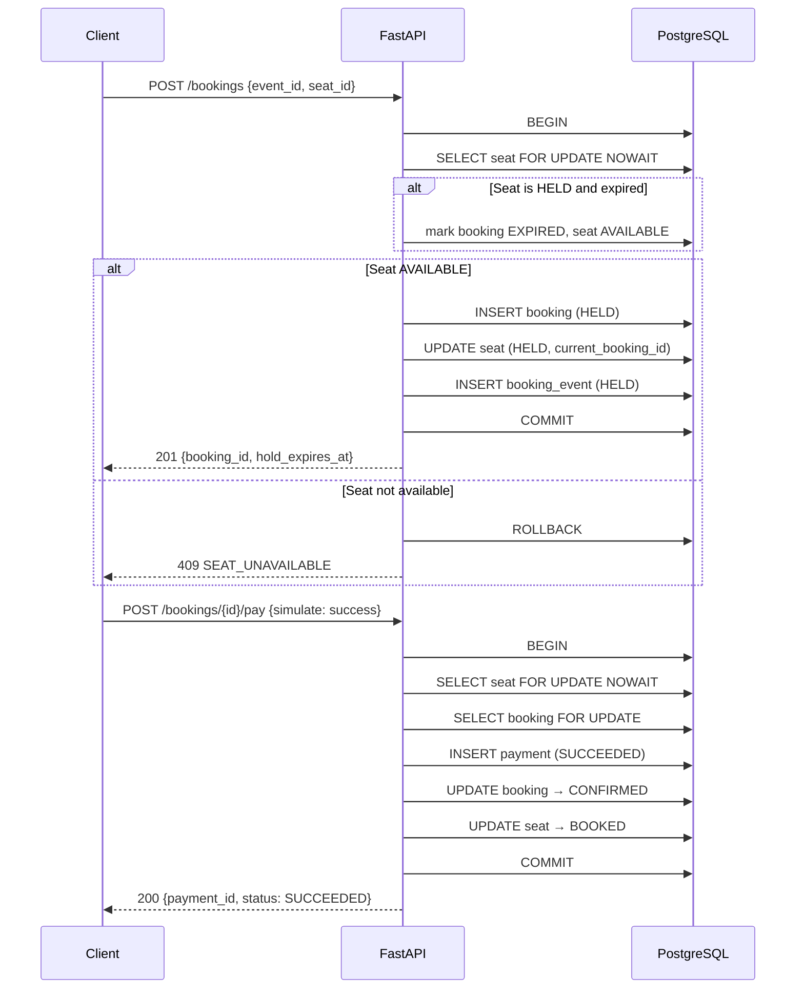
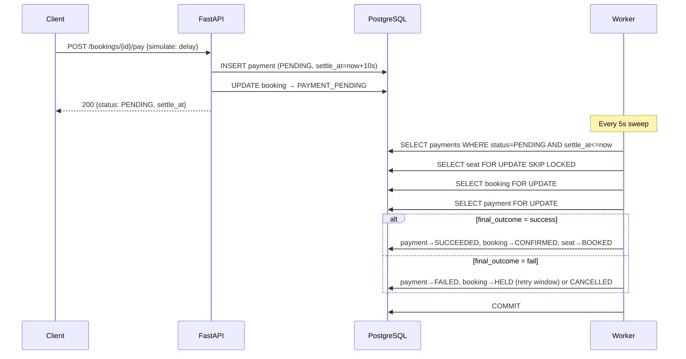
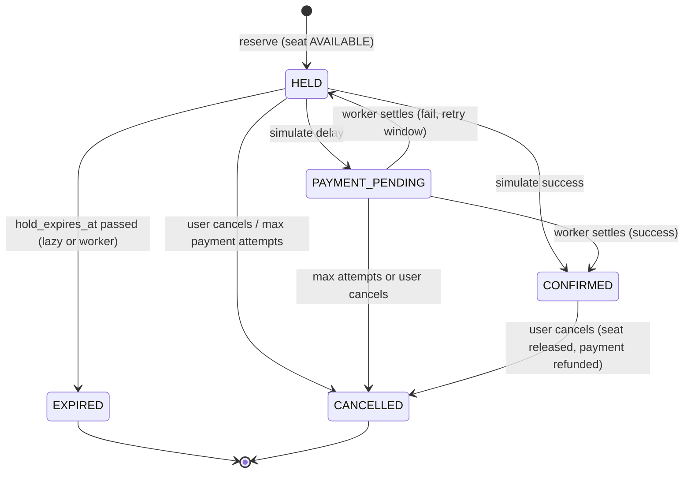
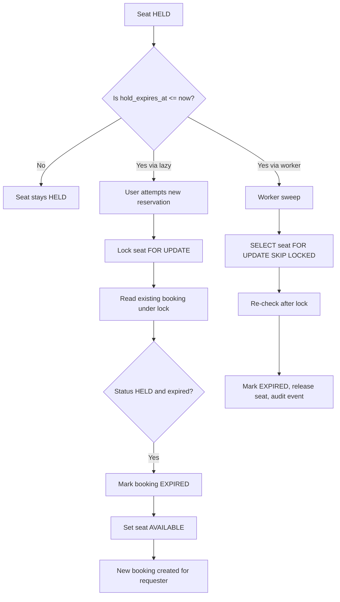

# WORKFLOWS.md — System Workflow Diagrams

## 1. Reserve → Pay → Confirm



## 2. Two Users Racing for One Seat

```mermaid
sequenceDiagram
    participant U1 as User 1
    participant U2 as User 2
    participant DB as PostgreSQL

    U1->>DB: BEGIN; SELECT seat FOR UPDATE NOWAIT → gets lock
    U2->>DB: BEGIN; SELECT seat FOR UPDATE NOWAIT → 55P03 (lock not available)
    U2-->>U2: 409 SEAT_BUSY (fail fast)
    U1->>DB: INSERT booking, UPDATE seat → HELD
    U1->>DB: COMMIT
    Note over DB: Partial unique index ensures only one active booking
```

## 3. Delayed Payment Settlement



## 4. Booking State Machine



## 5. Hold Expiry and Seat Release


